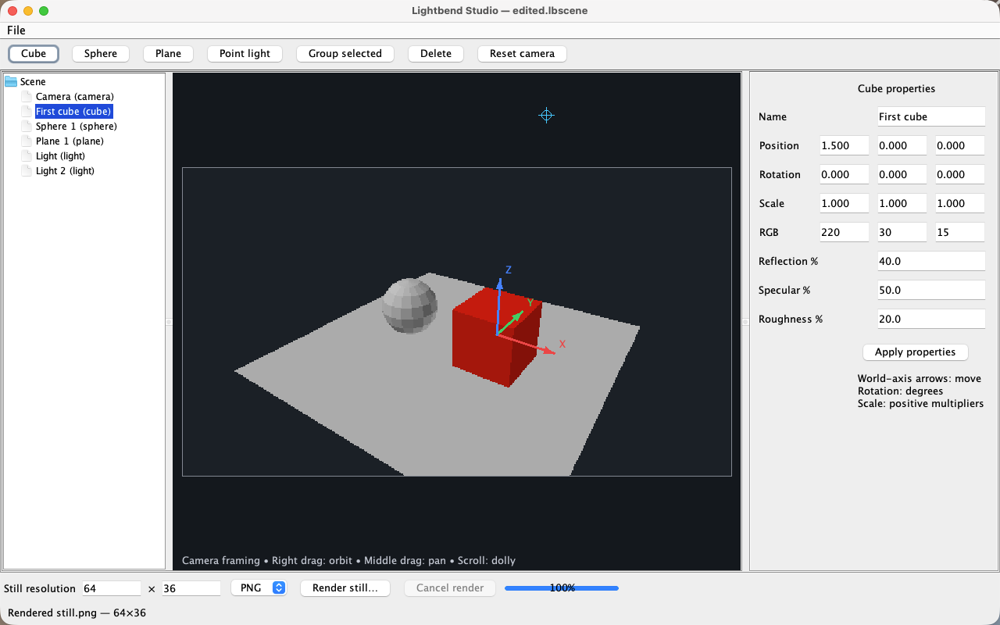
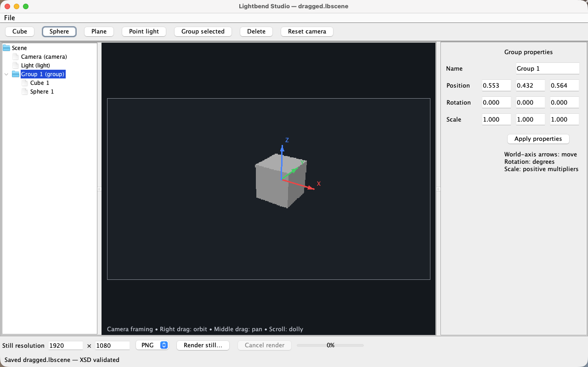
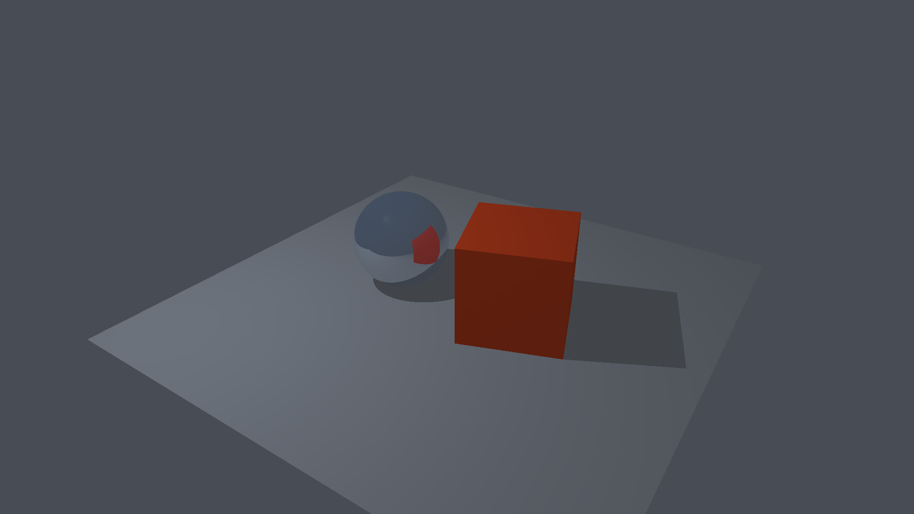

# First-slice execution evidence

Executed 2026-10-13 on Apple Silicon macOS (arm64). Runtime: JRuby 10.1.2.0, Ruby compatibility 4.0.0, Amazon Corretto/OpenJDK 25.0.1+8-LTS. Minitest 5.27.0 is included with the runtime.

## Installation and commands

- An isolated clean copy of `bin/setup`, `bin/jruby`, `Gemfile` and `Gemfile.lock` downloaded JRuby, verified SHA-256 `6dcb361bc1df554803fdd0243dc7c7a42723ac88a4b6f66830026afe82db28a8`, and installed all locked dependencies successfully. Local receipt: `tmp/receipts/fresh-setup.txt`.
- `bin/setup` on the working checkout also passed, reporting that dependencies were satisfied.
- `bin/check` exited 0: **15 core tests / 38 assertions** and **5 real desktop tests / 27 assertions**, all with zero failures, errors or skips. Local receipt: `tmp/receipts/full-check.txt`.
- `bin/run` opened the editor and kept its native window live; this uses the same Editor class exercised by the desktop tests.

## Requirement coverage

| Requirement | Authoritative proof |
| --- | --- |
| JRuby/JDK runtime and analyzers | Executed pinned runtime and tool commands; locked gems and full harness output |
| Primitive creation, one-level groups, inherited transforms | Public Scene tests and actual Swing controls; saved group XYZ values checked independently by SceneFile.load |
| Numeric position/rotation/scale and material editing | Public transform tests; desktop property edits persisted and reopened |
| Solid CPU preview and viewport selection | Rasterized pixel/picking test plus a real mouse click selecting the saved cube |
| RGB X/Y/Z translation arrows | Native Robot mouse drags on all three visible axes, verified through saved XML |
| Editable point-light position, RGB and brightness | Real property controls; reopened light RGB/brightness asserted; rendered light color test |
| True mirror reflection, specular, roughness, hard shadows | Rendered public-ray/pixel tests with independently constructed scenes, plus actual full-resolution render |
| XML and XSD enforced on reads/writes | Valid round trip, rejected version/range/scale/attribute/reference/DOCTYPE documents, precision regression, failed-save preservation |
| PNG/BMP/JPG and custom dimensions | Actual files encoded, reopened by JDK ImageIO, dimensions checked; real render dialog exported PNG |
| Application runtime lifetime | Entry point stays active while the window is visible and returns after disposal |
| Responsive rendering and cancellation | Background render completes through real GUI; Cancel button aborts default-resolution job without output |
| Safe invalid/large dimensions | Allocation guards tested; temporarily invalid text retains usable preview and prevents invalid rendering |
| macOS setup/run documentation | README commands; clean installation, complete harness, native launch proof |

The desktop tests use visible Swing windows, actual file chooser approval callbacks and native mouse input. They detect uncaught event-thread exceptions. Screenshots cover only the application window.

## Render and visual evidence

`examples/reflection.lbscene` contains grouped cube/sphere, a plane, a camera and a point light. Actual CPU render timings on this machine (including encoding): **320×180: 3.310 seconds**, **1920×1080: 50.615 seconds**. These are single observed runs, not a general performance guarantee. Local timing receipt: `tmp/receipts/full-render.txt`.

## Analyzer results and limits

Executed under JRuby: RuboCop **1.92.0**, Flay **2.14.4**, Reek **6.6.0**. Current complete check: **0 RuboCop lint offenses**; **206 full RuboCop findings**, **371 Reek smells**, **Flay duplication score 204** remain visible advisory diagnostics. Reek documents exit 2 for smells and exit 1 for execution errors; the harness distinguishes them. Raw reports are in `tmp/quality/`. No claim of zero style/smell/duplication warnings is made.

TDD red/green receipts are retained in `tmp/receipts/` for grouping, invalid edits, XML, DTD rejection, small decimal coordinates, image pixels, mirrors, cube occlusion, colored shadows, specular, rough reflection, image export, viewport drag invalid GUI resolution and application lifetime. Initial native paint failures were fixed; final desktop suite reports no event-thread exceptions.

Only macOS Apple Silicon was validated. Still rendering is bounded to two reflection bounces and four deterministic rough-reflection samples; no animation, imported meshes, global illumination or soft shadows. Screenshots and stills are execution artifacts, not mocked outputs.
